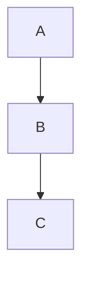

# Docsify: Components and Plugins

Distilled from docsifyjs/docsify (v4.x). Docsify has no compiled component system; all
"components" are either raw HTML/Markdown patterns or optional plugins added via CDN scripts.

## Core patterns (no plugin required)

### Callouts / blockquotes

No built-in admonition component. Use blockquotes for emphasis:
```md
> **Note:** This is important.

> **Warning:** Be careful here.
```

Or use HTML:
```html
<div style="border-left: 4px solid #4CAF50; padding: 10px; background: #f9f9f9;">
  This is a tip.
</div>
```

### Badges

Use external badge services (no built-in component):
```md


```

### Details/accordion

Standard HTML works:
```html
<details>
  <summary>Click to expand</summary>
  Hidden content here.
</details>
```

## Plugins (add script tags to `index.html`)

### Flexible alerts (admonitions)

```html
<script src="//cdn.jsdelivr.net/npm/docsify-plugin-flexible-alerts"></script>
```

Usage:
```md
> [!NOTE]
> A note.

> [!TIP]
> A tip.

> [!WARNING]
> A warning.

> [!DANGER]
> Danger!
```

### Tabs

```html
<script src="//cdn.jsdelivr.net/npm/docsify-tabs@1"></script>
```

Config in `window.$docsify`:
```js
tabs: { persist: true, sync: true, theme: 'material' }
```

Usage:
```md
<!-- tabs:start -->
#### **npm**
```sh
npm install my-package
```

#### **yarn**
```sh
yarn add my-package
```
<!-- tabs:end -->
```

### Copy code button

```html
<script src="//cdn.jsdelivr.net/npm/docsify-copy-code/dist/docsify-copy-code.min.js"></script>
```

No config needed; adds a copy button to all fenced code blocks automatically.

### Pagination (prev/next)

```html
<script src="//cdn.jsdelivr.net/npm/docsify-pagination/dist/docsify-pagination.min.js"></script>
```

Config:
```js
pagination: {
  previousText: 'PREV',
  nextText: 'NEXT',
  crossChapter: true,
}
```

### Edit on GitHub

```html
<script src="//cdn.jsdelivr.net/npm/docsify-edit-on-github"></script>
```

Config:
```js
plugins: [
  EditOnGithubPlugin.create('https://github.com/org/repo/blob/main/docs/')
]
```

### Zoom images

```html
<script src="//cdn.jsdelivr.net/npm/docsify@4/lib/plugins/zoom-image.min.js"></script>
```

All images become click-to-zoom by default. Exclude with `<!-- {docsify-ignore} -->` after the image.

### Mermaid diagrams

```html
<script src="//cdn.jsdelivr.net/npm/mermaid/dist/mermaid.min.js"></script>
<script src="//cdn.jsdelivr.net/npm/docsify-mermaid@latest/dist/docsify-mermaid.js"></script>
```

Config:
```js
mermaid: { startOnLoad: true }
```

Usage:
```md

```

## Theme customization

Override CSS variables in `index.html` or a custom CSS file:
```css
:root {
  --theme-color: #3F51B5;
  --sidebar-width: 300px;
  --content-max-width: 900px;
}
```

Link a custom stylesheet:
```html
<link rel="stylesheet" href="/custom.css">
```

## Notes

- There is no component import syntax (no JSX, no MDX).
- All enhancements are opt-in plugins loaded via CDN `<script>` tags in `index.html`.
- Plugin configuration goes in the `window.$docsify` object (see `configuration.md`).
- Docsify's plugin API allows custom plugins via `window.$docsify.plugins` array, but
  third-party CDN plugins are the common path.
