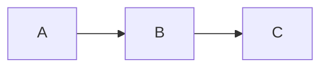

# Docusaurus: Content Authoring

Distilled from facebook/docusaurus (v3.x). Uses MDX v3 (supports React components in `.mdx`).

## File types

- `.md` — standard Markdown; no JSX/React components.
- `.mdx` — MDX (Markdown + JSX). Import and use React components.

## Admonitions (callouts)

```md
:::note
Note content.
:::

:::tip[Custom title]
Tip with a custom title.
:::

:::info
:::

:::warning
:::

:::danger
:::
```

## Code blocks

Fenced code blocks with syntax highlighting (Prism):

````md
```js title="src/hello.js"
function hello() {
  console.log('Hello, World!');
}
```
````

Line highlighting:
````md
```js {1,3-5}
const a = 1;   // highlighted
const b = 2;
const c = 3;   // highlighted
const d = 4;   // highlighted
const e = 5;   // highlighted
```
````

Show line numbers: ` ```js showLineNumbers `

## Tabs (MDX only)

```mdx
import Tabs from '@theme/Tabs';
import TabItem from '@theme/TabItem';

<Tabs>
  <TabItem value="apple" label="Apple" default>
    This is an apple.
  </TabItem>
  <TabItem value="orange" label="Orange">
    This is an orange.
  </TabItem>
</Tabs>
```

Synced tabs across the page: `<Tabs groupId="os">`.

## Details (collapsible)

```mdx
<details>
  <summary>Toggle me!</summary>

  Markdown content inside a collapsible block.
</details>
```

## Import Markdown

```mdx
import MyContent from './myContent.md';

<MyContent />
```

## React/JSX in MDX

```mdx
import Highlight from '@site/src/components/Highlight';

Some text, then a <Highlight color="#25c2a0">highlighted phrase</Highlight>.
```

## Math (KaTeX)

Install `remark-math` + `rehype-katex`, configure in `docusaurus.config.js`, then:
```md
Inline: $E = mc^2$

Block:
$$
\int_0^\infty e^{-x} dx = 1
$$
```

## Mermaid diagrams

Enable: `markdown: { mermaid: true }` + `@docusaurus/theme-mermaid` plugin.

````md

````

## Asset references

```md

```

Or in MDX: `import myImage from './assets/my-image.png'; `

Static assets (no processing): place in `static/img/`; reference as `/img/filename.png`.

## Partial documents

Place reusable fragments in `docs/_partials/` (underscore prefix hides them from sidebar):
```mdx
import Partial from './_partials/common-steps.md';
<Partial />
```

## Table of contents

Auto-generated from `##` and `###` headings. Adjust depth via frontmatter:
```yaml
toc_min_heading_level: 2
toc_max_heading_level: 4
```
