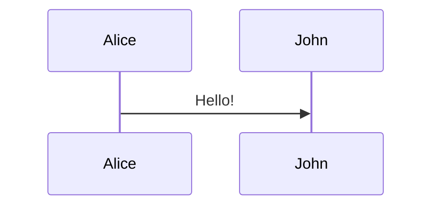

# VitePress: Content Authoring

Distilled from vuejs/vitepress (v1.x). Uses markdown-it + Vue-in-Markdown.

## Custom containers (callouts)

```md
::: info
Information callout.
:::

::: tip Custom Title
Tip with a custom title.
:::

::: warning
Warning callout.
:::

::: danger STOP
Danger callout with custom label.
:::

::: details Click to expand
Hidden content.
:::
```

## Code blocks

````md
```js
console.log('Hello, World!')
```

```ts{1,3-5}
const a = 1     // highlighted
const b = 2
const c = 3     // highlighted
```

```js:line-numbers
// line numbers enabled
const a = 1
```
````

Focus mode (dim non-focused lines):
````md
```js
export default {
  data() {
    return { // [!code focus]
      msg: 'Hello' // [!code focus]
    }
  }
}
```
````

Diff highlighting:
````md
```js
const removed = 'old' // [!code --]
const added = 'new'   // [!code ++]
```
````

Code group (tabbed):
````md
::: code-group
```sh [npm]
npm install vitepress
```
```sh [pnpm]
pnpm add vitepress
```
```sh [yarn]
yarn add vitepress
```
:::
````

## Snippet import

Import code from external files:
```md
<<< @/src/example.ts
<<< @/src/example.ts{1,3-5}     # with highlight
<<< @/src/example.ts{ts}        # language override
<<< @/src/example.ts#region     # named region: // #region / // #endregion
```

## Vue components in Markdown

VitePress runs Markdown through Vue. Use Vue syntax and global components:

```md
The count is {{ 1 + 1 }}.

<span v-if="true">Visible</span>

<Badge type="tip" text="New" />
```

Escaped: `<span v-pre>{{ literal }}</span>`

## Importing Vue components

Place components in `docs/.vitepress/theme/` or any path; import in Markdown:

```md
<script setup>
import MyComponent from './MyComponent.vue'
</script>

<MyComponent />
```

## Math (requires markdown-it-mathjax3)

Install: `npm add -D markdown-it-mathjax3`; enable: `markdown: { math: true }` in config.

```md
Inline: $E = mc^2$

Block:
$$
\int_0^\infty e^{-x} dx = 1
$$
```

## Mermaid (via vitepress-plugin-mermaid or custom)

```md

```

## Table of contents (in-page)

Insert `[[toc]]` anywhere to render an inline TOC.

## Links

- Internal links: relative paths (`.md` or without extension).
  `[Page](./guide.md)` or `[Page](./guide)` — VitePress rewrites to the final URL.
- External links: auto-opened in new tab with `rel="noopener noreferrer"`.
