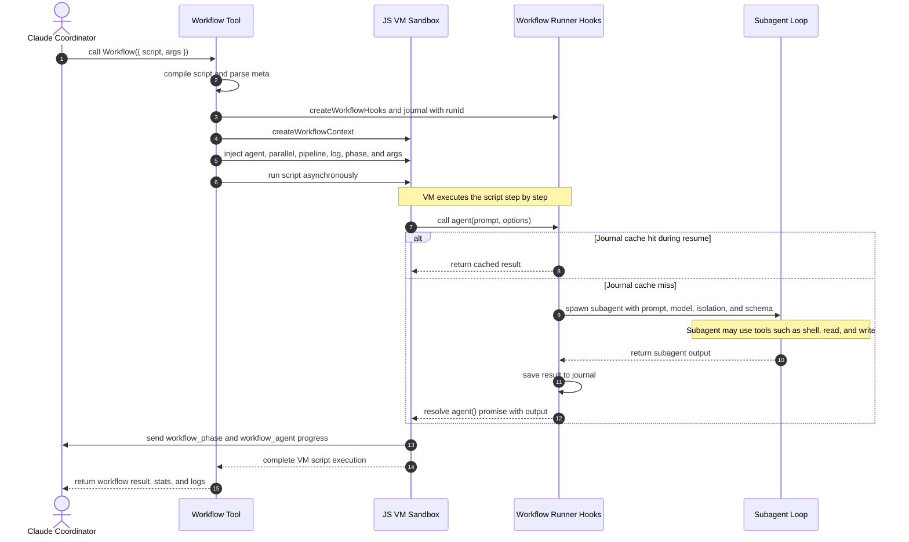

# Workflow Analysis

Claude Code dynamic workflows are a server-managed framework for scripting and
orchestrating complex, multi-agent software engineering pipelines.

Instead of manually coordinating workers through a long chat transcript, the
coordinator can delegate orchestration to a deterministic JavaScript or
TypeScript workflow script. The script runs inside an in-process VM sandbox.

## Runtime Areas Reviewed

This analysis comes from the workflow runtime, coordinator prompts, saved workflow
handling, managed-agent instructions, and related cloud-run scheduling paths.

The relevant implementation areas are:

- Subagent execution through `runAgent` and the `Agent` tool.
- `Workflow` tool schema validation, script compilation, and task registration.
- `runWorkflowScript`, the VM harness that executes workflow scripts with
  `vm.runInContext`.
- `createWorkflowContext`, the context builder that injects `agent`, `parallel`,
  `pipeline`, and `workflow`.
- `createWorkflowHooks`, the runner primitive layer for subagent state, git
  worktree isolation, retries, and budgets.
- Coordinator-mode prompts for `SendMessage`, `Agent`, `Workflow`, task assignment,
  synthesis, and concurrency control.
- Task claiming, `TaskList` integration, managed agents, and memory-store guidance.
- Cloud-run scheduling paths for remote execution infrastructure.

## Runtime Flow

When the `Workflow` tool is called, the runner parses the script `meta` block,
initializes a thread-safe resumable execution journal, creates a Node.js VM
context with `createWorkflowContext`, injects workflow globals, and runs the script
through `runWorkflowScript`.

## Entry Points and CLI Controls

Dynamic workflows can be triggered through user-facing CLI paths that all connect
back to the VM execution engine.

1. `ultracode: <task>`

   Prefixing a task with `ultracode:` signals the coordinator to plan and draft a
   workflow script instead of solving the request turn by turn.

   The CLI highlights the keyword. The user can dismiss the highlight with
   `Option+W` on macOS, `Alt+W` on Windows or Linux, or by backspacing. Trigger
   behavior can be disabled in `/config`.

2. `/effort ultracode`

   This raises reasoning effort to `xhigh` and configures the session to design
   and execute workflows automatically for substantive tasks.

   A substantive task can produce sequential workflows, for example analysis,
   implementation, and verification.

3. `/deep-research`

   Claude Code includes bundled workflows. `/deep-research <question>` runs a
   fan-out web search across multiple research angles, cross-checks findings,
   and produces a cited synthesized report.

   This workflow requires the `WebSearch` tool.

## Sandbox APIs

The VM context created by `createWorkflowContext` restricts arbitrary Node.js APIs
such as `process` and `fs`. It injects async orchestration hooks that are safe for
workflow execution.

### `agent(prompt, options)`

`agent()` spawns an autonomous worker to execute the task described by `prompt`.

Internally, `createWorkflowHooks` wraps the request, tracks it as a workflow agent
step, and then hands execution to the `runAgent` loop.

If `options.schema` is supplied, the runner requires structured output. The worker
must submit its final answer through the `StructuredOutput` tool.

If the worker completes without calling the structured-output tool, the runner uses
a structured-output retry prompt to request the expected output.

Arguments:

- `prompt` is the worker instruction string.
- In worktree isolation, workspace directory information is appended automatically.
- `options.label` sets the progress display name.
- `options.phase` groups progress under a workflow phase.
- `options.model` overrides the model for that worker.
- `options.effort` accepts `low`, `medium`, `high`, or `max`, then normalizes that
  value before execution.
- `options.isolation` accepts `worktree` or `remote`.

Isolation behavior:

- `worktree` runs workers in isolated git checkouts.
- `remote` is intended for cloud-run dispatch, but local execution rejects it in this
  build with `agent({isolation:'remote'}) is not available in this build`.

Remote cloud containers are therefore handled through separate non-local endpoints,
not by the local VM runner.

### `parallel(...fns)`

`parallel()` runs multiple workflow tasks concurrently.

It expects an array of functions that return promises, such as `() => agent(...)`.
It must not receive already-created promises.

That function boundary prevents eager execution outside the VM scheduler's control.
Internally, the runner wraps the tasks with `Promise.allSettled()`.

### `pipeline(items, ...stages)`

`pipeline()` streams array items through sequential callback stages.

The runner maps over the items and stage callbacks, then coordinates completion with
`Promise.allSettled()`.

Use it when each item should pass through the same ordered processing path.

### `log(message)` and `phase(title)`

`log()` emits workflow log messages. `phase()` marks active milestones.

Both send progress objects back to the coordinator session, including
`workflow_log` and `workflow_phase` events.

## Determinism and Resume

Workflow resume depends on deterministic script execution.

The deterministic-script validator audits the script body. It rejects
non-deterministic APIs such as `Math.random()`, `Date.now()`, and `new Date()`.

Every `agent()` call is hashed with `computeJournalKey(...)`. The hash covers the
prompt, schema, isolation, model, and preceding chain state.

When `resumeFromRunId` is supplied, the runner checks the journal for a cached
result under that hash. If found, it returns the cached worker output immediately.

The cache is session-scoped. After the Claude Code CLI exits, the next session should
be treated as a fresh workflow run.

## Limits, Scheduling, and Retries

The runtime enforces hard boundaries to keep workflows from becoming runaway jobs.

- Total agents per run are capped by `MAX_AGENTS_PER_RUN = 1000`.
- Exceeding the cap throws `WorkflowAgentCapExceededError`, the runaway-loop
  protection error.
- Concurrency is capped at 16 agents, or fewer depending on CPU core availability.
- Stall detection uses `DEFAULT_STALL_TIMEOUT_MS`.
- Stalled steps are retried up to `MAX_STALL_RETRIES` times.

The runner also contains a hidden safety backoff for degraded API behavior.

If an agent completes in less than `stallTimeoutMs * 0.5` seconds without a stop
reason, the runner sleeps for 45 seconds before retrying.

## Saving and Resolution

When a workflow run completes, the user can save the script from the `/workflows`
progress view by pressing `s`.

Save locations:

- Project workflows are saved to `.claude/workflows/` and can be committed to git.
- Personal workflows are saved to `~/.claude/workflows/` and are global to the user.

Resolution precedence:

- In monorepos, supported in Claude Code `v2.1.178` and later, resolution walks from
  the current working directory up to the repository root.
- Project workflows take precedence over personal workflows.
- If multiple `.claude/workflows/` directories define the same workflow name, the
  directory closest to the current working directory wins.

## Documentation Gaps

Some runtime behavior is stricter or more specific than the public documentation
implies.

| Topic | Public documentation | Observed implementation |
| --- | --- | --- |
| `args` parsing | Saved workflows accept input as `args`. | `args` must parse as JSON arrays or objects. Stringified JSON can fail later when scripts call array methods such as `filter` or `map`. |
| Resume lifetime | Workflows can resume from the `/workflows` menu or prompt. | Resume data is session-scoped. After the CLI exits, the next session starts fresh. |
| Background execution | Workflows run in the background. | The runner includes a hidden 45-second retry sleep for suspiciously fast completions without a stop reason. |
| Remote isolation | Remote execution is described as cloud-based. | The local runner rejects `isolation: "remote"` in this build. Remote execution is handled elsewhere. |

## Developer Takeaways

Treat workflows as deterministic orchestration scripts, not general Node.js programs.

Keep worker contracts inline in prompts. The runtime does not dynamically load skills
for `agent()` calls, and `agentType` only resolves registered session agents.

Use `parallel()` with functions, not promises. Passing promises defeats the scheduler's
control over when work starts.

Design for resume by keeping prompts, schemas, model choices, isolation, and stage order
stable. Those values affect the worker hash.

Use workflows when orchestration is worth preserving or repeating. For one-off tasks,
a normal conversation with subagents is usually cheaper and easier to inspect.
